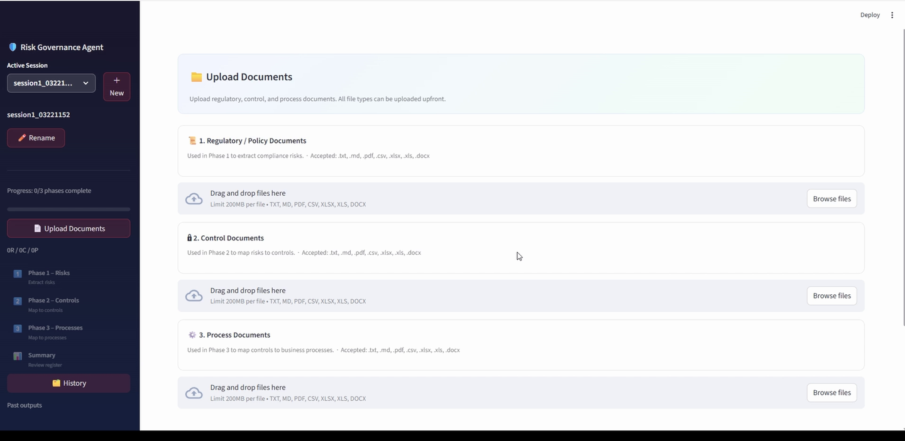
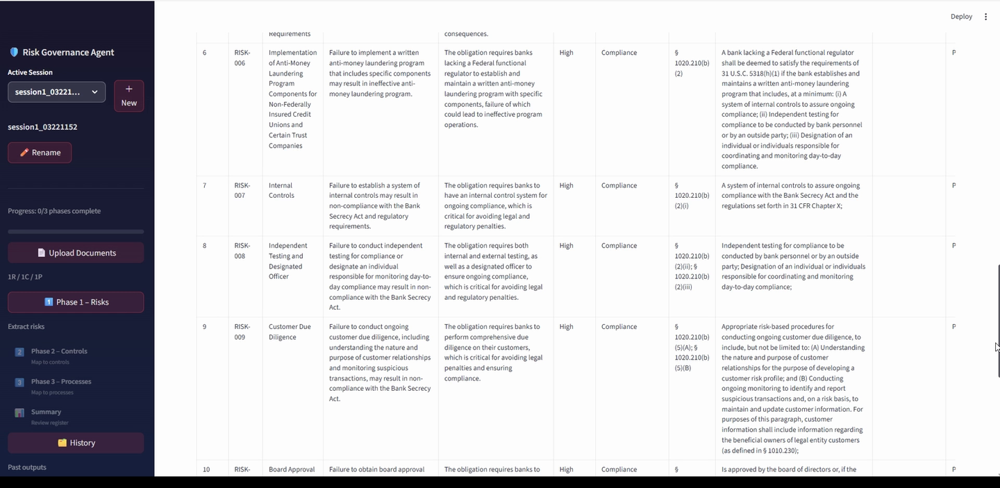
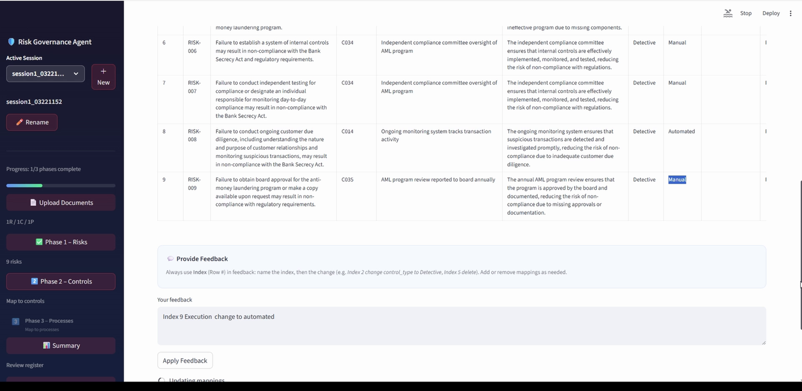
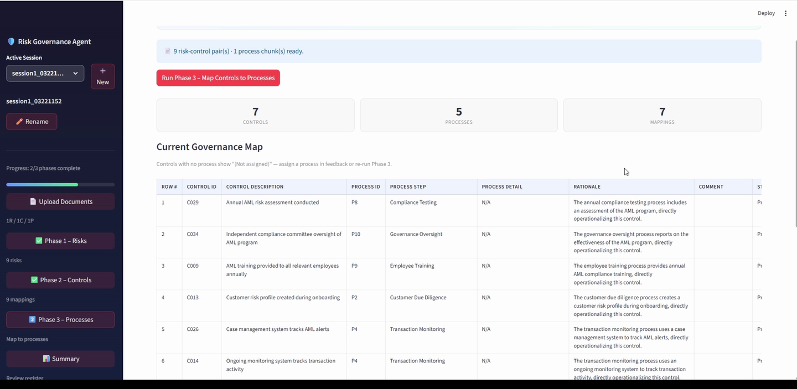
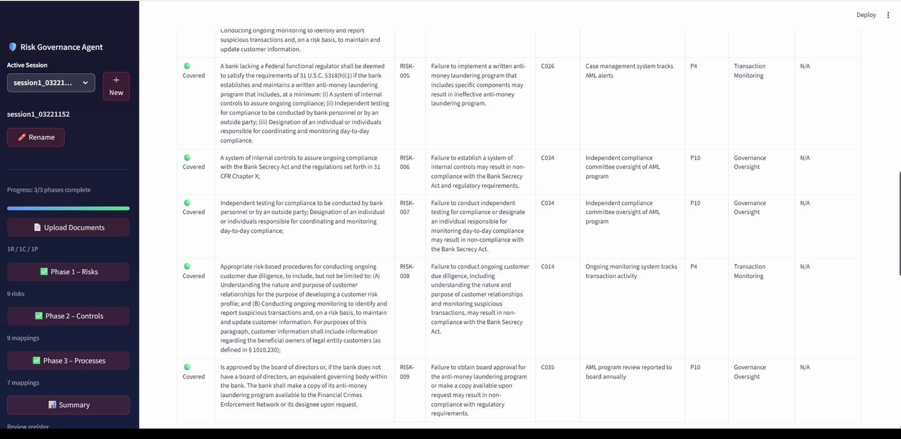
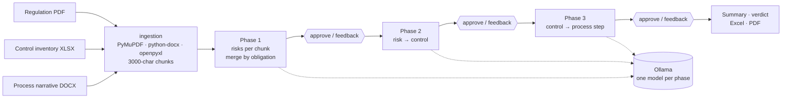

<h1 align="center">SLM Risk Governance Agent</h1>

<p align="center">
  <b>Regulation in, governance register out.</b> A three-phase compliance agent that reads a regulation, proposes the risks, maps them to your control inventory, then maps the controls to your process narratives. A human approves every phase.
</p>

<p align="center">
  <a href="#walkthrough">Walkthrough</a> ·
  <a href="#how-it-works">How it works</a> ·
  <a href="#the-models">The models</a> ·
  <a href="#run-it">Run it</a> ·
  <a href="#training-pipeline">Training</a>
</p>

<p align="center">
  
</p>

Compliance teams turn regulations into risk registers by hand: read the clause, write the risk, find the control, find the process step. The result is rarely MECE (mutually exclusive, collectively exhaustive), rarely traceable, and never consistent between analysts. This agent does the first draft of all three steps with small, fine-tuned language models and keeps the analyst in charge of every row.

Everything runs locally through [Ollama](https://ollama.com). No document leaves the machine.

## Walkthrough

### 1. Upload one document per role

A regulation or policy (PDF, DOCX, TXT), a control inventory (XLSX, CSV) and a process narrative (DOCX). The five sample sets under `data/test_docs/` pair public-domain US anti-money-laundering rules (31 CFR 1020.210, 1020.220, 1020.320, 1010.230 and 1010.311) with synthetic control inventories and process narratives.



### 2. Phase 1: regulation to risks

Each chunk of the regulation becomes a set of candidate risks in the COSO shape: obligation, objective, failure scenario. Every row carries the source clause and a supporting quote, a severity and a category. Duplicate obligations from neighbouring chunks are merged before you see them.



Reviewers approve, reject or edit rows, or type feedback in plain language such as "index 3 change severity to High" or "index 7 add note needs legal review". The agent revises the register and returns it for another look.

### 3. Phase 2: risks to controls

Approved risks are matched against the control inventory. Each mapping explains why the control mitigates that specific failure and labels it preventive, detective or corrective and manual, automated or hybrid.



### 4. Phase 3: controls to process steps

Approved controls are placed on the process narrative, one row per control per step, with the operational rationale.



### 5. Summary, verdict and export

The summary page shows coverage counts, flags risks with no control and controls with no process, and exports the full register to Excel or a PDF report. Sessions are saved as they go and reopen from History.



A complete approved run on Set 3 is in `docs/sample-run/` as JSON.

## How it works



| Piece | What it does | Where |
|---|---|---|
| Ingestion | Extracts text from PDF, DOCX, XLSX, CSV, TXT and chunks it with overlap | `ingestion.py` |
| Phase runners | One LLM call per chunk, JSON parsing with repair, ID assignment, dedup by obligation and by quote | `phases/` |
| Prompts | Phase prompts, feedback revision prompts, summary prompt. The Python modules are the source of truth | `prompts/` |
| Schemas | Pydantic rows for the risk register, the risk-control matrix and the governance map | `schemas.py` |
| LLM client | Ollama HTTP client with retries, timeouts and strict JSON extraction | `llm_client.py` |
| UI | Streamlit pages per phase, session manager with autosave, history, exporters | `ui/` |

Stack: Python 3.10 · Streamlit · Ollama · Pydantic · PyMuPDF · python-docx · openpyxl · fpdf2

## The models

| | Full system | This repo, out of the box |
|---|---|---|
| Base | Qwen2.5-7B-Instruct | gemma2:2b |
| Adaptation | QLoRA, one adapter per phase, merged and exported to GGUF | none |
| Ollama names | `coso_phase_1`, `coso_phase_2`, `coso_phase_3` | `gemma2:2b` for every phase |
| Size | about 15 GB | about 1.5 GB |

The fine-tuned weights are too large to ship here. The default config runs the same pipeline on a small public model so anyone can try it in minutes. To use your own fine-tuned models, train them with the scripts below and point `PHASE_MODELS` in `config.py` at them.

## Run it

```bash
# 1. install Ollama, then pull the small model
ollama pull gemma2:2b

# 2. python environment
python -m venv venv
venv\Scripts\activate            # macOS/Linux: source venv/bin/activate
pip install -r requirements.txt

# 3. run
streamlit run app.py
```

On Windows, `setup.bat` then `launcher.bat` do the same. `check_flow.py` verifies the imports without touching Ollama. Set `OLLAMA_BASE_URL` if Ollama runs on another machine.

Then upload the three files from `data/test_docs/Set 3` and run the phases in order.

## Training pipeline

`training_reference/` holds the complete fine-tuning workflow for the full system.

1. **Labels**: five document sets, each with expected JSON for all three phases, written to the same methodology the prompts enforce.
2. **Data prep**: `prepare_training_data.py` builds ChatML JSONL per phase using the exact prompt builders the app uses, so training and inference see the same instructions.
3. **Training**: `train_phase.py` runs QLoRA (4-bit base, LoRA rank adapters, TRL `SFTTrainer`) per phase.
4. **Packaging**: `export_to_ollama.py` and `register_coso_models.py` turn adapters into Ollama models from the Modelfiles in `modelfiles_ft/`.
5. **Evaluation**: `evaluate.py` replays the test sets through Ollama and scores schema validity, row count match, ID recall and field fill against the expected JSON.

`TRAINING_REVIEW.md` records the main lesson: training examples showed each phase the whole document, while the app runs one chunk at a time, which caused over-splitting in Phase 1 until stronger canonical-risk and dedup rules were added to the prompt. Chunk-level training examples are the next step.

## Limits

- Model output quality depends on the model behind Ollama. The small default is enough to see the workflow, not to trust the register.
- One LLM call per chunk means a long regulation takes minutes on CPU.
- Deposits of sector-specific knowledge, such as which control types are acceptable for a given obligation, live in the fine-tuned adapters, not in the code.

## License

MIT. Sample regulations are US federal public-domain text. Sample control inventories and process narratives are synthetic.
